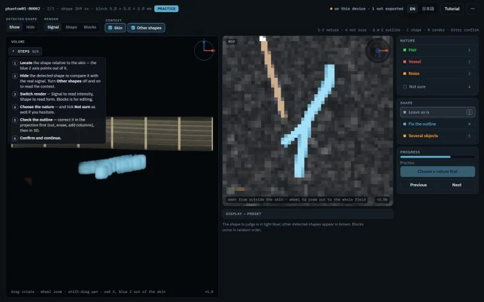

# Tubular 3D Annotator

A browser-based tool to **review, correct and label thin tubular structures in 3D volumes**, with several readers working remotely. It was built to create the human ground truth of a study on body-hair segmentation in 3D photoacoustic imaging (vessels vs. hairs vs. noise), and runs as a static web page: no server, no install for readers.



> The repository ships with **synthetic data only** (a procedural phantom). No patient data is included.

## What a reader does

Each *block* (a 48³ voxel box) is centred on one automatically detected candidate. The reader:

1. **locates** the shape relative to the skin (estimated surface drawn in the volume);
2. **decides its nature**: hair, vessel, noise (+ "not sure");
3. **checks the outline** and fixes it if needed: add or erase voxels, fill gaps, trace along the signal, or **cut** a candidate that merges several objects;
4. **confirms**, and moves to the next block.

Features:

- **WebGL2 ray-marched volume view** (signal / voxels / editable blocks), with skin surface and neighbouring candidates, plus a **maximum-intensity projection** that zooms out to the whole field of view;
- **voxel editing tools**: 1- and 7-voxel brush, eraser, bucket fill, gap filling, cuts into parts;
- **interactive tutorial** with practice blocks, **English / Japanese** interface;
- per-reader identifiers, resumable sessions, reading order with anchor blocks;
- answers saved **locally in the browser** and **exported as JSON**, then merged with `tools/collect_answers.py`.

The code also contains the other steps of the original protocol (search for missed objects, second reading of the author's outlines, blind arbitration between readers). They need extra data files that `build_cohort.py` does not produce yet; the default page is the review step.

## Quick start (demo)

```bash
git clone https://github.com/Mortgat/tubular-3d-annotator.git
cd tubular-3d-annotator/app
python -m http.server 8000
```

Open <http://localhost:8000>, enter any reader ID, and follow the tutorial. The demo cohort (`app/data/demo/`, 57 blocks from two phantom volumes) is loaded by default.

## Build a cohort from your own volumes

Requirements: Python 3.10+, `pip install -r requirements.txt` (NumPy, SciPy, Pillow).

1. Save one `.npz` per volume with:

   | key | type | meaning |
   |---|---|---|
   | `signal` | float, `(X, Y, Z)` | the volume. **z is the depth axis and grows into the tissue** (air at low z, then skin, then tissue) |
   | `labels` | int, `(X, Y, Z)` | candidate components from your detector, `0` = background |
   | `skin` | float, `(X, Y)` | skin height, in z voxels; `NaN` where unknown |
   | `spacing_mm` | float, `(3,)` | voxel size along x, y, z |

   All volumes of one cohort must share the same `(X, Y)` size.

2. Build the cohort into a folder served by the page:

   ```bash
   python tools/build_cohort.py my_volumes/*.npz --out app/data/study1
   ```

3. Open `http://localhost:8000/?data=study1`.

Each candidate becomes one block. The box step (1, 2 or 4 voxels per display cell) is chosen so that the candidate fits; the signal is max-pooled, divided by a per-volume display ceiling and stored as lossless WebP atlases (16 blocks per image). See the docstring of [`tools/build_cohort.py`](tools/build_cohort.py) for the exact encoding.

### Recreate the demo data

```bash
python tools/phantom.py --out phantom_data --volumes 2 --seed 7
python tools/build_cohort.py "phantom_data/*.npz" --out app/data/demo --truth phantom_data --truth-out examples/demo_truth.json
python tools/make_tutorial_images.py phantom_data/phantom01.npz --out app/tuto
```

The phantom contains a wavy skin surface, branching vessels under it, hairs leaving the skin at an angle (some lying on it), isolated noise blobs, and one hair crossing a vessel that the "detector" merges into a single candidate.

## Collect the answers

Readers click **⋯ → Export my answers** and send you the JSON file. Then:

```bash
python tools/collect_answers.py exports/*.json --out answers.csv
# on the demo, compare with the phantom's truth:
python tools/collect_answers.py exports/*.json --truth examples/demo_truth.json
```

## Deploy

The page is static: any web server works. The included workflow (`.github/workflows/pages.yml`) publishes `app/` to **GitHub Pages** on every push to `main` (enable it in *Settings → Pages → Source: GitHub Actions*). Readers then only need the link, e.g. `https://<user>.github.io/tubular-3d-annotator/?data=demo`.

Deployment settings live in [`app/config.js`](app/config.js): data folder (`?data=`), the author's reader ID (`?author=`), and optional links between the pages of a two-step campaign.

## Repository layout

```
app/                    the web page (open app/index.html through a web server)
  app.js                annotator: state, WebGL rendering, tools, storage, export
  strings.js            interface texts (EN / JA)
  tutorial.js           tutorial screens and figures
  config.js             deployment settings
  data/demo/            synthetic demo cohort
  tuto/                 tutorial figures, rendered from the phantom
tools/
  phantom.py            synthetic volumes
  build_cohort.py       volumes (.npz) -> cohort for the page
  make_tutorial_images.py
  collect_answers.py    exported answers -> CSV (+ agreement with a truth file)
examples/               phantom truth and a sample export
```

Code comments are mostly in French (the original working language); interface texts are in English and Japanese.

## Context and citation

This tool produced the human ground truth used to evaluate MIRAH:

> R. Décarpentries, Y. Onoue, H. Kajita, R. Bise, M. Isogawa. *MIRAH: Annotation-Free 3D Body-Hair Segmentation in Photoacoustic Volumes From a Recipe Defined in Millimeters.* Submitted to IEEE ISBI 2027 (under review).

It was developed in an AI-assisted way (Claude), with every design decision, check and protocol choice made by the author.

## License

MIT — see [LICENSE](LICENSE).
